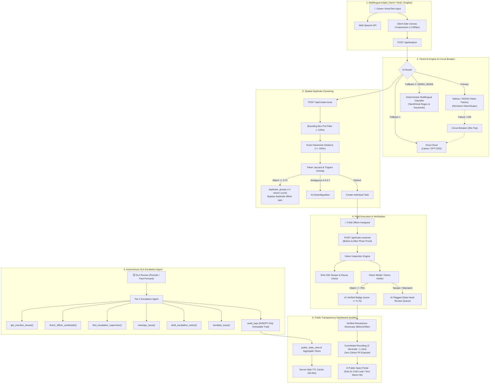

# AllalKalai (அல்லல் களை) — Autonomous Civic Grievance & Accountability Platform

> *"அல்லற்பட்டு ஆற்றாது அழுதகண் ணீரன்றே செல்வத்தைத் தேய்க்கும் படை"* — **திருக்குறள் 555**  
> *"His people's tears of sorrow past endurance, are not they / Sharp instruments to wear the monarch's wealth away"*  
> **Core Tagline**: *"Weed out the suffering"*

AllalKalai is a production-grade, closed-loop civic intelligence platform transforming public grievance redressal into an autonomous, transparent, and accountable pipeline: **Multilingual Intake → AI Triage & Extraction → Spatial Duplicate Clustering → Autonomous Escalation → Multimodal Vision Verification → Open Public Accountability**.

---

## 🏛️ System Architecture



---

## ⚡ Quick Setup in 6 Steps

Follow these 6 steps to start the entire stack locally:

### Step 1: Clone and Enter Repository
```bash
git clone https://github.com/visha-21/AllalKalai.git
cd AllalKalai/Query-manager
```

### Step 2: Install Backend & Frontend Dependencies
```bash
npm install --prefix backend
npm install --prefix frontend
```

### Step 3: Configure Environment Variables
Copy `.env.example` to `backend/.env`:
```bash
cp .env.example backend/.env
```
*(Supabase URL, Anon Key, Service Role Key, and optional AI Keys are configured here. `DEMO_MODE=true` can be enabled for offline judge presentations).*

### Step 4: Seed Demo Data in 6 Seconds
```bash
npm run seed:demo --prefix backend
```
*Creates 10 demo profiles, baseline duplicate groups, overdue escalation issues, and verified showcases.*

### Step 5: Start the Development Servers
In two separate terminals:
```bash
# Terminal 1: Backend API (port 4000)
npm run dev --prefix backend

# Terminal 2: Frontend Web App (port 5173)
npm run dev --prefix frontend
```

### Step 6: Open the Application
- **Public Transparency Dashboard**: [http://localhost:5173/public](http://localhost:5173/public) (no login required)
- **Role Portal Sign In**: [http://localhost:5173/login](http://localhost:5173/login)

---

## 🔑 Pre-Configured Demo Accounts

All demo accounts share the password: `demo123456`

| Role | Email | Purpose |
|---|---|---|
| **Citizen** | `citizen@demo.com` | Multilingual text/speech intake & cluster tracking |
| **Water Officer** | `officer-water@demo.com` | Assigned tasks & genuine resolution photo upload |
| **Roads Officer** | `officer-roads@demo.com` | Field work & tamper/mismatch photo testing |
| **Water Dept Head** | `depthead-water@demo.com` | Escalation audit panel & fast-forward demo trigger |
| **Roads Dept Head** | `depthead-roads@demo.com` | Review & approval queue for flagged photo evidence |
| **Commissioner** | `official@demo.com` | Cross-department performance benchmarks & orders |

---

## 🧪 Automated Test & Verification Suites

```bash
# 1. End-to-End Smoke Test (exercises steps a-f via API)
npm run smoke --prefix backend

# 2. Concurrency & Latency Benchmark (20 concurrent users: p95 < 1.5s)
npm run test:load --prefix backend

# 3. Resilience & Failure Drills (Zero-keys, invalid keys, disabled vision, offline network)
npm run test:drills --prefix backend

# 4. Phase-Specific Verification Suites
npm run test:ai --prefix backend     # Phase 2 AI Triage & Fallback
npm run test:p3 --prefix backend     # Phase 3 Duplicates & Vision
npm run test:p4 --prefix backend     # Phase 4 Escalation Agent
npm run test:p5 --prefix backend     # Phase 5 Public UI & Zero-PII
```

---

## 📋 Technology Stack Summary

- **Frontend**: React 19, Vite 8, TypeScript, Tailwind CSS v4, Lucide Icons, Vite PWA
- **Backend**: Node.js, Express, TypeScript, Zod Schema Validation
- **Database & Storage**: Supabase (PostgreSQL with RLS policies, Storage buckets)
- **AI Models & Inference**:
  - **Tier 1 (Triage & Language)**: NVIDIA Nemotron-3 Nano / Groq Cloud
  - **Tier 2 (Escalation Reasoning)**: NVIDIA Nemotron-3 Super / Ultra
  - **Vision (Photo Verification)**: NVIDIA Nemotron-3.5 Super-VL
  - **Zero-AI Fallback**: Deterministic regex & keyword classifier (`classifyWithRules`)
